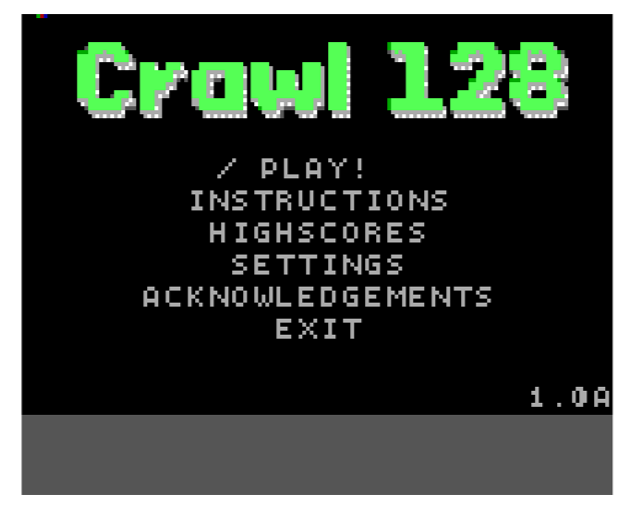
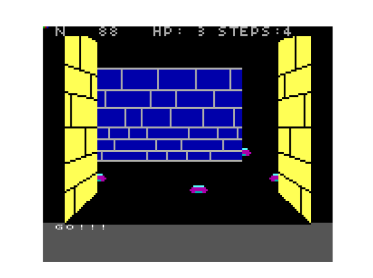
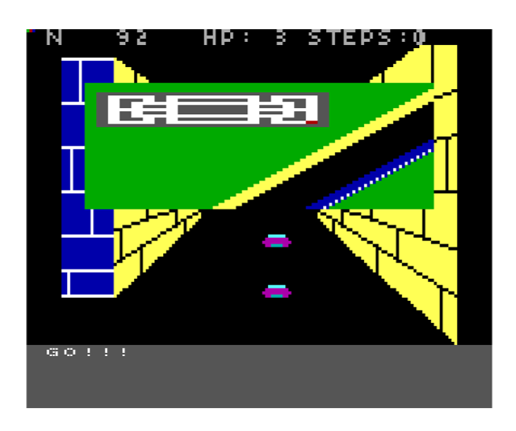

# Crawl 128

A first-person, grid-based dungeon crawler for the **Commodore 128 in 128 mode**. Everything is drawn on
the **VDC** (the 80-column chip) with **64 KB of video RAM**. The game is written in BASIC 7.0 with
VDC-BASIC extensions and compiled with Blitz! 128.



Crawl 128 was started for the [Dungeon Crawler Jam 2025](https://itch.io/jam/dcjam2025)
(DCJam 2025, 11–20 April 2025). It was not finished in time, so the credits call it "nearly a submission".
The game mixes a dungeon crawler with Pac-Man: collect the gems, avoid or fight the ghost, find the exit.
The core idea comes from *3D Munch* for the Oric Atmos. Development continued after the jam. The devlog
is on the [itch.io page](https://goodwell.itch.io/crawl128).

By **Goodwell** and **The 8-Bit Theory**. MIT licensed (see [LICENSE](LICENSE)).

## Download and start

Use the newest image:

| Image | Drive | Notes |
|---|---|---|
| [`crawl128-100f.d81`](crawl128-100f.d81) | 1581 or compatible (SD2IEC, Ultimate, Pi1541, FD-2000 …) | recommended |
| [`crawl128-100f.d64`](crawl128-100f.d64) | 1541 / 1571 | same files, 431 blocks free |

Both images **autoboot**: insert the disk and switch on or reset the C128 (or type `BOOT`).
Without autoboot: `RUN"CRAWL128"`.

### System requirements

- Commodore 128, 128D or 128DCR in **C128 mode**. C64 mode is not supported.
- An **80-column (RGBI) monitor**, because everything is drawn on the VDC.
- **VDC with 64 KB VRAM.** The 128DCR has it as standard. The original C128 and the plastic 128D have
  16 KB and need the common 64 KB VRAM upgrade.
- A disk drive for the image you use (see above).
- **Emulation:** VICE `x128` with 80-column output and 64 KB VDC RAM, for example
  `x128 -80col -VDC64KB -drive8type 1581 -autostart crawl128-100f.d81`.

## How to play

- Collect all the gems. When none are left, the exit opens: find it.
- Don't get killed by the ghost. Press **F** to attack. Your attack range is 3 tiles, but the ghost can
  only attack adjacent tiles. It moves as fast as you do but cannot strafe.
- **W/S** forward/back, **A/D** strafe, **Q/E** turn left/right, **M** shows the automap.
- **1/2** switch the CPU between SLOW (1 MHz) and FAST (2 MHz).
- Keys can be remapped under *Settings*. The highscore table is saved on disk (`greatestcrawl128`).

| | |
|---|---|
|  |  |
|  |  |

## How it works

The game is a plain BASIC 7.0 program (`game/crawl.bas`) that uses three libraries:

| Library | Version | Purpose | Location |
|---|---|---|---|
| [VDC-BASIC](https://github.com/The8BitTheory/vdc-basic) | v2h (`vdcbasic2h.1300`) | BASIC extension for the VDC: VRAM fill/copy (`VMF`, `VMC`, `RTV`), bitmap text (`VMP`), transparent soft sprites (`VMS`), command lists (`VCL`) | bank 0, `$1300–$1BF6` |
| [dungeonboringengine](https://github.com/The8BitTheory/dungeonboringengine) | 0.1 (`dbe0.1.stub`, `dbe0.1.lib`) | First-person view in machine code. It works out which walls, gems and ghosts are visible and writes a single `VCL` list that draws the whole view in one BASIC call. Ghosts and gems are drawn transparently with `VMS` | stub bank 0 `$0D00`, lib bank 1 `$C000` |
| [Blitz! 128](https://github.com/The8BitTheory/blitz-compiler) | `blitzc` (JS re-implementation of the Skyles compiler V860929, fixed build V261123), *Improved 2026* runtime, fast math off | Compiles the BASIC program to Blitz! bytecode. The *Improved 2026* runtime is a faster drop-in runtime (variable/array access, NEXT) | program from `$1C01`, runtime `$FC00–$FEFF` |

Graphics: the 3D view is a low-resolution bitmap on the VDC. Wall pieces, font, title and ghost pictures
are kept as pre-converted data in VRAM and copied by the VDC itself (VDC block copy). The CPU only decides
*what* to copy *where*. Since 1.0f this part is done by the engine in machine code instead of in BASIC.

### Memory map (1.0f, measured in the running compiled game)

| Bank | Range | Use |
|---|---|---|
| 0 | `$0B00–$0BFF` | `VCL` list (written by the engine) |
| 0 | `$0C00–$0C14` | engine parameter block and object list |
| 0 | `$0D00–$0D83` | engine stub (bank switching, interrupt handling) |
| 0 | `$0E00–$0FFF` | engine `VMS` buffer |
| 0 | `$1300–$1BF6` | VDC-BASIC v2h |
| 0 | `$1C01–$70E7` | compiled program (Blitz! bytecode) |
| 0 | `$94E8–$ECC0` | load buffer for `walls.vdc` before it goes to VRAM |
| 0 | `$F2DE–$FBFF` | title buffer |
| 0 | `$FC00–$FEFF` | Improved 2026 runtime |
| 1 | `$0400–$11EB` | variables and arrays (strings stay below `$8000`) |
| 1 | `$8000` / `$A000` | level map / the engine's working copy of it |
| 1 | `$C000–$C87F` | engine lib |
| 1 | `$E000` / `$E200` / `$EA00` | metadata for walls, ghost and gem (`walls.wsm`, `ghost.spr`, `gem.spr`) |

## Performance

All numbers come from VICE (`x128`, PAL, 64 KB VRAM) with the same fixed walk of 39 key presses through
the first level. The two tables were measured in different ways, so only compare numbers within a table.

**Whole walk** (compiled):

| Version | Runtime | Time |
|---|---|---|
| 1.0c | original Blitz! runtime | 6.90 s |
| 1.0d | Improved 2026 runtime, fast math off | 6.03 s (−13 %) |
| 1.0d, VDC-BASIC v2h instead of v2g | same | 6.02 s (no change) |

**Sum of the time from each key press to the next key prompt**, which is the time spent drawing:

| Version | Rendering | Compiled | Interpreted |
|---|---|---|---|
| 1.0e | in BASIC, ghosts as transparent `VMS` sprites | 7.36 s | – |
| 1.0f | dungeonboringengine 0.1 | **4.69 s (−36 %)** | 22.96 s |

In 1.0f a step forward takes about 216,000 cycles (1.0e: 373,000–452,000). A turn takes
157,000–197,000 cycles (1.0e: 236,000–393,000).

Older recordings of the interpreted and the compiled game, from before the engine:
[`media/crawl basic.gif`](media/crawl%20basic.gif), [`media/crawl blitz.gif`](media/crawl%20blitz.gif).

## Version history

| Version | Changes |
|---|---|
| 0.99b–0.99e1 | builds from the jam period |
| 1.0–1.0c | first releases: title screen, highscores, key mapping, automap, sound |
| 1.0d | Improved 2026 Blitz! runtime, VDC-BASIC v2h. Title buffer moved below `$FC00` |
| 1.0e | ghosts drawn transparently (`VMS`) instead of as black rectangles |
| 1.0f | view calculated and drawn by dungeonboringengine 0.1: about 36 % faster, clean transparent ghosts, program 2.4 KB smaller |

## Repository layout

| Path | Content |
|---|---|
| `crawl128-*.d81`, `.d64` | release disk images, one per version (newest: `100f`) |
| `game/crawl.bas` | **game source** (BASIC 7.0 + VDC-BASIC, RetroDevStudio format, `#` lines are comments) |
| `game/crawl.prg` | tokenized source, input for the Blitz! compiler |
| `game/mapgen.bas` | map generator |
| `game/loader.bas`, `slowfast.bas`, `vtest.bas`, `timedemo.bas` | small experiments and test programs |
| `game/crawl-04-15.*`, `timedemo-04-15.*`, `crawl.d81`, `blitzcrawl.d81` | snapshots from the jam (April 2025) and development disks |
| `libs/` | library binaries: VDC-BASIC (`vdcbasic2d.0ac6`, `2g.1300`, `2h.1300`) and the engine (`dbe0.1.stub`, `dbe0.1.lib`) |
| `art/` | source graphics: walls, font, title and ghosts, plus unused goblins, trees and water. `art/ghost-opaque/` holds the opaque ghost pictures. `art/dbe/` holds the engine data made from them and explains how it was made |
| `tools/` | BASIC tools that run on the C128 (BMP → VDC conversion, merging wall sets, font test) and host tools: `bas2prg.py` (tokenizer for `crawl.bas`), `ghostvms.py` (transparent ghost lists for 1.0e) |
| `testing/platforms/` | the dungeon view as a small test program for other BASICs: BASIC 3.5 (C16/Plus/4), BASIC 7.0, Walrus BASIC 8, BASIC 65 (MEGA65) |
| `vdccrawl.d71` | early development disk |
| `media/` | screenshots and recordings |
| `docs/VICE_PRAXIS.md` | notes on automated testing with VICE |

## Building

Needs Python 3, Node.js and VICE's `c1541`, plus local clones of
[vdc-basic](https://github.com/The8BitTheory/vdc-basic) (for its tokenizer `test/bastok.py`, expected
next to this repository) and [blitz-compiler](https://github.com/The8BitTheory/blitz-compiler).

```sh
python3 tools/bas2prg.py game/crawl.bas game/crawl.prg          # tokenize
node ../blitz-compiler/blitz128/blitzc/js/cli.js game/crawl.prg out/ \
     --runtime improved --fastmath off                          # compile; out/c.prg becomes crawl128
```

To build a disk, copy the newest `.d81` and replace `crawl128` with `c1541`. The boot sector stays, so
the copy still autoboots. The engine files are built in
[dungeonboringengine](https://github.com/The8BitTheory/dungeonboringengine) (`engine/build.sh`, tag `v0.1`).

## Thanks

From the in-game acknowledgements: Tokra, Mac Bacon, Elysium, OziPhantom, Xahmol, the VICE team,
WillyManilly and Vintage Computing Carinthia, and Michael Brough for being an inspiration.
Dedicated to Julia and Ben.
