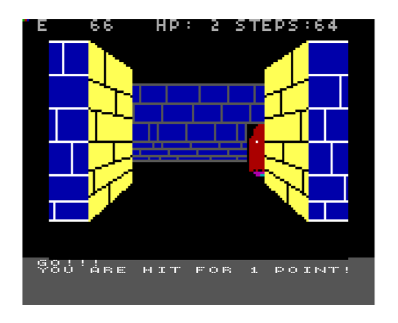
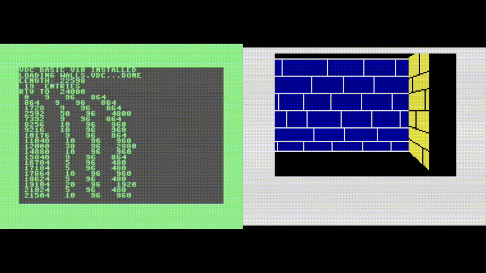

# Crawl 128

A first-person, grid-based dungeon crawler for the **Commodore 128 in 128 mode**. Everything is drawn on
the **VDC** (the 80-column chip) with **64 KB of video RAM**. The game is written in BASIC 7.0 with
VDC-BASIC extensions and compiled with Blitz! 128.


Crawl 128 was started for the [Dungeon Crawler Jam 2025](https://itch.io/jam/dcjam2025)
(DCJam 2025, 11–20 April 2025). It was not finished in time, so the credits call it "nearly a submission".
The game mixes a dungeon crawler with Pac-Man: collect the gems, avoid or fight the ghost, find the exit.
The core idea comes from *3D Munch* for the Oric Atmos. Development continued after the jam. The devlog
is on the [itch.io page](https://goodwell.itch.io/crawl128).

By **Goodwell** and **The 8-Bit Theory**. MIT licensed (see [LICENSE](LICENSE)).

## Download and start

Use the newest image:

| Image | Drive | Notes |
|---|---|---|
| [`crawl128-110.d81`](crawl128-110.d81) | 1581 or compatible (SD2IEC, Ultimate, Pi1541, FD-2000 …) | recommended, 2952 blocks free |
| [`crawl128-110.d64`](crawl128-110.d64) | 1541 / 1571 | same files, 456 blocks free |

Both images **autoboot**: insert the disk and switch on or reset the C128 (or type `BOOT`).
Without autoboot: `RUN"BOOT"`. Since 1.1 the game cannot be started with `RUN"CRAWL128"` any more: `BOOT`
first loads VDC-BASIC v3 to `$1C00`, which has to be in memory before the program (the program stops with
`RUN "BOOT" FIRST` otherwise). The last version before that, 1.0f, is still in the repository
([`crawl128-100f.d81`](crawl128-100f.d81), [`.d64`](crawl128-100f.d64)).

### System requirements

- Commodore 128, 128D or 128DCR in **C128 mode**. C64 mode is not supported.
- An **80-column (RGBI) monitor**, because everything is drawn on the VDC.
- **VDC with 64 KB VRAM.** The 128DCR has it as standard. The original C128 and the plastic 128D have
  16 KB and need the common 64 KB VRAM upgrade.
- A disk drive for the image you use (see above).
- **Emulation:** VICE `x128` with 80-column output and 64 KB VDC RAM, for example
  `x128 -80col -VDC64KB -drive8type 1581 -autostart crawl128-110.d81`.

## How to play

- Collect all the gems. When none are left, the exit opens: find it.
- Don't get killed by the ghost. Press **F** to attack. Your attack range is 3 tiles, but the ghost can
  only attack adjacent tiles. It moves as fast as you do but cannot strafe.
- **W/S** forward/back, **A/D** strafe, **Q/E** turn left/right, **M** shows the automap (the whole dungeon, as in 1.0f).
- **1/2** switch the CPU between SLOW (1 MHz) and FAST (2 MHz).
- Keys can be remapped under *Settings*. The highscore table is saved on disk (`greatestcrawl128`).

| | |
|---|---|
|  |  |
|  |  |

## How it works

The game is a plain BASIC 7.0 program (`game/crawl.bas`) that uses three libraries:

| Library | Version | Purpose | Location |
|---|---|---|---|
| [VDC-BASIC](https://github.com/The8BitTheory/vdc-basic) | v3 (`vdcbasic3`, branch `v3`, with `VCL` entry type 10 from P2e) | BASIC extension for the VDC: VRAM fill/copy (`VMF`, `VMC`, `RTV`), bitmap text (`VMP`), transparent soft sprites (`VMS`), command lists (`VCL`, in v3 also with a jump entry), and new in v3 `RXV` (unpack a run-length coded picture file into VRAM). Loaded by `BOOT` | bank 0, `$1C00–$3FFF` |
| [dungeonboringengine](https://github.com/The8BitTheory/dungeonboringengine) | 0.2 (`dbe0.2.stub`, `dbe0.2.lib`) | First-person view in machine code. It works out which walls, gems and ghosts are visible and writes the `VCL` list that draws the whole view. Data comes as ready-made files: view geometry (DVG), wall textures (DTS), sprite sets (S2) and the map (DMP). Pictures are unpacked into VRAM by `RXV` | stub bank 0 `$0D00`, lib bank 1 `$B000–$DBFF` |
| [Blitz! 128](https://github.com/The8BitTheory/blitz-compiler) | `blitzc` (JS re-implementation of the Skyles compiler V860929, fixed build V261123), *Improved 2026* runtime, fast math off, **runtime image 2** | Compiles the BASIC program to Blitz! bytecode. *Image 2* is the build with the program at `$4001`, because VDC-BASIC v3 occupies `$1C00–$3FFF`. The *Improved 2026* runtime is a faster drop-in runtime (variable/array access, NEXT) | program and runtime from `$4001`, runtime vectors `$FC00–$FEFF` |

Graphics: the 3D view is a low-resolution bitmap on the VDC. Wall pieces, font, title and ghost pictures
are kept as pre-converted data in VRAM and copied by the VDC itself (VDC block copy). The CPU only decides
*what* to copy *where*. Since 1.0f this part is done by the engine in machine code instead of in BASIC.
Version 1.1 uses engine 0.2, which draws the same pictures (see *Version history*). Font and title are stored
as VRL files (RLE) and unpacked by `RXV`: the font file is 1406 bytes instead of 1732, the title 1021 bytes
instead of 2340. The title stays packed in RAM and is unpacked every time the menu is shown.

### Memory map (1.1, measured in the running game)

The addresses of the compiled game (Blitz! image 2) and the interpreted one differ only in the program area.

| Bank | Range | Use |
|---|---|---|
| 0 | `$0B00–$0BFF` | reserve of the engine |
| 0 | `$0C00–$0CFF` | engine parameter block (`$0C00`), object list (`$0C50`) |
| 0 | `$0D00–$0DFF` | engine stub (bank switching, interrupt handling) |
| 0 | `$1300–$1BFF` | engine buffer (`VCL` list and `VMS` lists) |
| 0 | `$1C00–$3FFF` | VDC-BASIC v3 |
| 0 | `$4001–$96B7` | compiled program: Blitz! runtime image 2 and bytecode (interpreted: BASIC text `$4001–$8018`) |
| 0 | `$96B8–$CFFF` | load buffer for the VRL files (14,664 bytes; interpreted from `$8019`: 20,455 bytes). The largest file is `walls.vrl` with 6050 bytes. `RXV` cannot read `$D000–$DFFF`, so the buffer ends at `$CFFF` |
| 0 | `$F805–$FBFF` | title picture, packed (`title.vrl`, 1019 bytes after the load address) |
| 0 | `$FC00–$FEFF` | Improved 2026 runtime vectors |
| 1 | `$0400–$0684` | variables and arrays (compiled; strings from `$3FFF` down, the string area ends at `$1211`) |
| 1 | `$4000` / `$5000` | level map (DMP) / the engine's working copy of it |
| 1 | `$6000` / `$7000` | ghost sprite set / gem sprite set (S2) |
| 1 | `$8000` | wall textures (DTS) |
| 1 | `$B000–$DBFF` | engine lib (10,982 bytes of code, 282 bytes free) |
| 1 | `$E800` | view geometry (DVG) |

VRAM (64 KB): `$0000` screen attributes and text, `$2580` title buffer at start-up, `$4B00` font, then the wall
pictures (22,354 bytes), ghost pictures (1,882 bytes), gem picture (36 bytes) and the automap (440 bytes). The
view bitmap (screen RAM of the bitmap mode) starts at 46335 (`$B4FF`). The pictures and the automap end at about
45,640, which leaves a reserve of about 690 bytes.

## Performance

**Method.** The fixed walk of 39 key presses through the first level (`WWEWWEWWQWW…`). Measured is the **sum of
the time from each key press to the next key prompt**, which is the time spent drawing and thinking. The
release builds are measured unchanged (no test code in them). 1.0f and 1.1 were measured with the same
harness in the same session; the numbers in the 1.0f README (4.69 s / 22.96 s) came from another method and could
not be reproduced, so they are not repeated here.

- **VICE** (`x128`, PAL, 64 KB VRAM, `test/vice_crawl.py --timing`): the stopwatch of the monitor between the
  key press and the prompt, in CPU cycles. It counts 1 MHz cycles even in FAST mode. Seconds = cycles / 985,248
  (the cycle count of one PAL frame is measured in every run).
  Each configuration ran twice; the table shows the mean.
- **Z64K** (`test/z64k_crawl.py`), a more accurate VDC emulation: a time-demo build plays the 39 keys itself and
  writes the elapsed jiffies (`TI`) to a file. 1 s = 60.15 jiffies (calibrated against the VICE cycle count).
  Resolution about 0.02 s.

| Configuration | CPU | 1.0f | 1.1 | Change |
|---|---|---|---|---|
| VICE, compiled | 2 MHz | 3.44 s | 3.15 s | -8.3 % |
| VICE, compiled | 1 MHz | 6.41 s | 5.96 s | -7.1 % |
| VICE, interpreted | 2 MHz | 21.87 s | 21.98 s | +0.5 % |
| VICE, interpreted | 1 MHz | 44.38 s | 44.74 s | +0.8 % |
| Z64K, compiled | 2 MHz | 4.32 s | 3.82 s | -11.5 % |
| Z64K, compiled | 1 MHz | 7.70 s | 7.13 s | -7.3 % |

"2 MHz" is the default of the game (FAST), "1 MHz" is after pressing **1** (SLOW). Interpreted runs were not made in
Z64K.

The 1.1 numbers are with VDC-BASIC v3 P2f: the row loop of `VMC`/`VMF` (VCL entries 1-5, also VMS type 2) runs
without JSR and writes the VDC registers directly, 20-30 % fewer cycles per row. Compiled, 1.1 is now 7 to 12 %
faster than 1.0f; interpreted it is as fast (+0.5 to +0.8 %, the time goes into BASIC). Before P2f 1.1 was practically
as fast as 1.0f (VICE 3.40 / 6.43 / 22.24 / 45.22 s, Z64K 4.26 / 7.63 s; VICE -1.0 to +1.9 %, Z64K -1.5 to -0.9 %). These numbers are also with the
fixed VCL list address (`BUFSET` X = 1: the engine puts a VCL jump, entry type 10 of VDC-BASIC v3, at the buffer start, so
the game calls `::VCL VB` with a variable set once instead of reading the address after every `VIEW`) and a stub that
saves the zero page only for `VIEW` and `GEOMSET`; before these two changes 1.1 was 0.8 to 2.8 % slower (VICE). It draws exactly the same pictures. The point of 0.2 is not speed in Crawl, but the features for new
games (floor and ceiling textures, windows with a landscape, sky, pits, animated sprites, see the
[engine demo](https://github.com/The8BitTheory/dungeonboringengine/tree/main/demo)).

Older recordings of the interpreted and the compiled game, from before the engine:
[`media/crawl basic.gif`](media/crawl%20basic.gif), [`media/crawl blitz.gif`](media/crawl%20blitz.gif).

## Version history

| Version | Changes |
|---|---|
| 0.99b–0.99e1 | builds from the jam period |
| 1.0–1.0c | first releases: title screen, highscores, key mapping, automap, sound |
| 1.0d | Improved 2026 Blitz! runtime, VDC-BASIC v2h. Title buffer moved below `$FC00` |
| 1.0e | ghosts drawn transparently (`VMS`) instead of as black rectangles |
| 1.0f | view calculated and drawn by dungeonboringengine 0.1: about 36 % faster, clean transparent ghosts, program 2.4 KB smaller |
| 1.1 | dungeonboringengine 0.2 and VDC-BASIC v3: the pictures are **pixel-identical to 1.0f** (checked at 74 prompts in VICE, interpreted and compiled, and in an offline comparison of 19,136 views). New memory layout: VDC-BASIC at `$1C00`, program at `$4001` (Blitz! runtime image 2), engine data as DVG/DTS/S2/DMP files, pictures as VRL files unpacked by `RXV`. Font and title are stored packed (1.6 KB less on disk). The game starts only via `BOOT`. Menu shows "1.1". The automap still shows the whole dungeon (`AM%=0` in the source); `AM%=1` switches to an "explored only" fog map made possible by the engine |

## Repository layout

| Path | Content |
|---|---|
| `crawl128-*.d81`, `.d64` | release disk images, one per version (newest: `110`) |
| `game/crawl.bas` | **game source** (BASIC 7.0 + VDC-BASIC, RetroDevStudio format, `#` lines are comments) |
| `game/crawl.prg` | tokenized source, input for the Blitz! compiler (load address `$1C01` as the compiler wants it; the interpreted disk gets `$4001`) |
| `game/mapgen.bas` | map generator |
| `game/loader.bas`, `slowfast.bas`, `vtest.bas`, `timedemo.bas` | small experiments and test programs |
| `game/crawl-04-15.*`, `timedemo-04-15.*`, `crawl.d81`, `blitzcrawl.d81` | snapshots from the jam (April 2025) and development disks |
| `libs/` | library binaries: VDC-BASIC (`vdcbasic2d.0ac6`, `2g.1300`, `2h.1300`, v3: `vdcbasic3.prg`), the engine (0.1: `dbe0.1.stub`, `dbe0.1.lib`; 0.2: `dbe0.2.stub.prg`, `dbe0.2.lib.prg`) and the boot loader `boot.prg` |
| `art/` | source graphics: walls, font, title and ghosts, plus unused goblins, trees and water. `art/ghost-opaque/` holds the opaque ghost pictures. `art/dbe/` holds the engine 0.1 data made from them, `art/dbe02/` the engine 0.2 data of 1.1 (DVG, DTS, S2, DMP, VRL) and explains how it was made |
| `tools/` | BASIC tools that run on the C128 (BMP → VDC conversion, merging wall sets, font test) and host tools: `bas2prg.py` (tokenizer for `crawl.bas`, `--start ADDR`), `mkdisk.py` (builds the 1.1 disk images), `vrlpics.py` (font and title as VRL), `ghostvms.py` (transparent ghost lists for 1.0e) |
| `test/` | tests of 1.1: pixel comparison against 1.0f in VICE (`vice_crawl.py`), smoke test, time measurement (`z64k_crawl.py`). See `test/README.md` |
| `build/` | work directory of `mkdisk.py` and the tests (not in git) |
| `testing/platforms/` | the dungeon view as a small test program for other BASICs: BASIC 3.5 (C16/Plus/4), BASIC 7.0, Walrus BASIC 8, BASIC 65 (MEGA65) |
| `vdccrawl.d71` | early development disk |
| `media/` | screenshots and recordings |
| `docs/VICE_PRAXIS.md` | notes on automated testing with VICE |

## Building

Needs Python 3, Node.js and VICE's `c1541`, plus local clones next to this repository of
[vdc-basic](https://github.com/The8BitTheory/vdc-basic) (branch `v3`; tokenizer `test/bastok.py`, `tools/mkboot.py`,
`vdcbasic3.bin`),
[blitz-compiler](https://github.com/The8BitTheory/blitz-compiler) and
[dungeonboringengine](https://github.com/The8BitTheory/dungeonboringengine) (`engine/build.sh`, tools). The
paths can be set with `VDCBASIC_DIR`, `BLITZC` and `DBE_DIR`; the Blitz! runtime with `BLITZ_RUNTIME` (default `improved`; the game needs it free of bank-1 code at `$FC00-$FEFF`, see source comments).

```sh
python3 tools/mkdisk.py build/crawl128-110.d81            # compiled game (Blitz! image 2) on a d81, with boot sector
python3 tools/mkdisk.py build/crawl128-110.d64            # the same on a d64
python3 tools/mkdisk.py --interp build/crawl128-110i.d81  # interpreted game ($4001) instead
python3 tools/mkdisk.py --rebuild-libs OUT.d81            # also copy the engine, VDC-BASIC v3 and boot loader to libs/ again
python3 tools/mkdisk.py --rebuild-assets OUT.d81          # also make art/dbe02/ again with crawlconv (needs crawl128-100f.d81)
```

`mkdisk.py` runs the steps `tools/bas2prg.py game/crawl.bas game/crawl.prg` (tokenize), the Blitz! compiler
(`--runtime improved --fastmath off`, the result must have load address `$4001`) and `c1541`. The disk gets `boot` as
the first file, so the boot sector autoboots it. The Blitz! compiler is not deterministic: two builds differ by a few
bytes.

Tests (VICE `x128` and, for the time measurement, Z64K, see `test/README.md`):

```sh
test/vice_crawl.py --ports 6637,6638     # 1.1 interpreted and compiled against 1.0f: VRAM and registers at every prompt
test/vice_crawl.py --timing --ports 6641,6642    # VICE time measurement
test/z64k_crawl.py                               # Z64K time measurement
```

The engine files are built in [dungeonboringengine](https://github.com/The8BitTheory/dungeonboringengine)
(`engine/build.sh`; the converter for the game data is `tools/crawlconv.py` there).

## Thanks

From the in-game acknowledgements: Tokra, Mac Bacon, Elysium, OziPhantom, Xahmol, the VICE team,
WillyManilly and Vintage Computing Carinthia, and Michael Brough for being an inspiration.
Dedicated to Julia and Ben.
